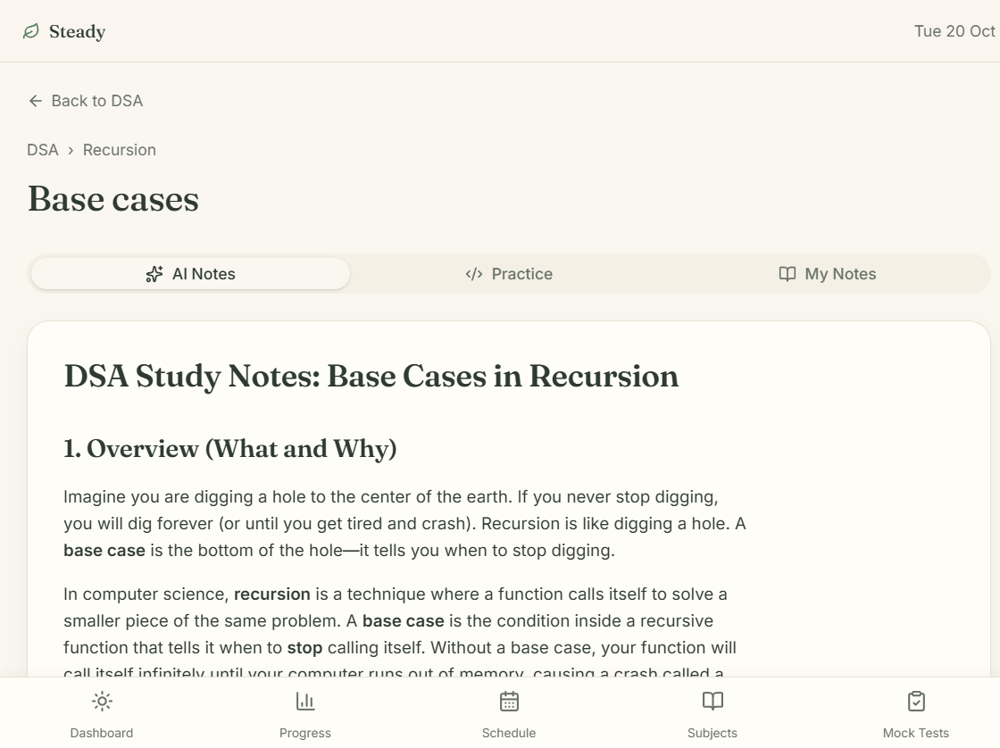
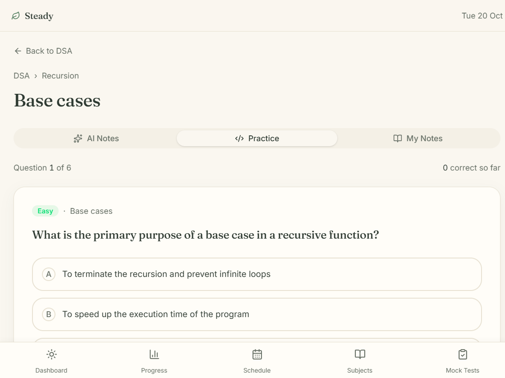
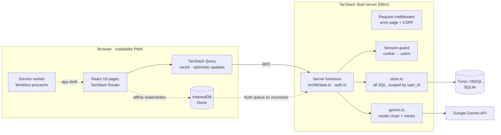
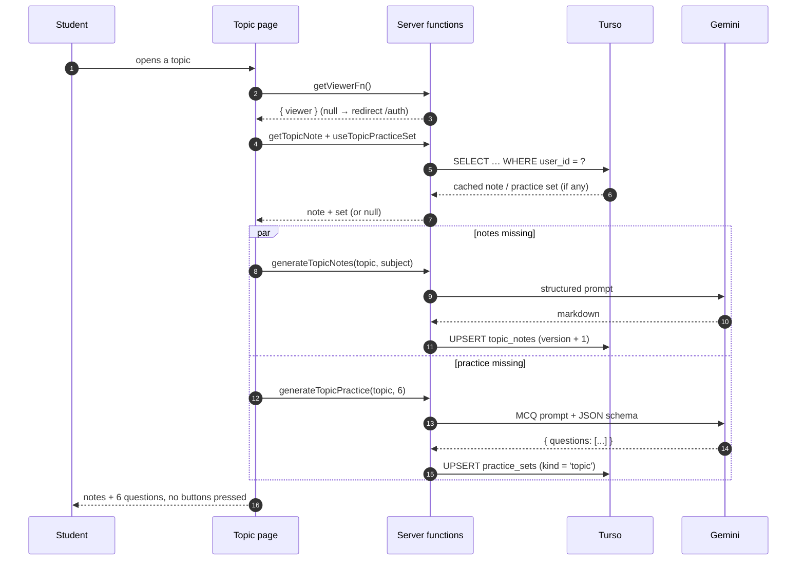
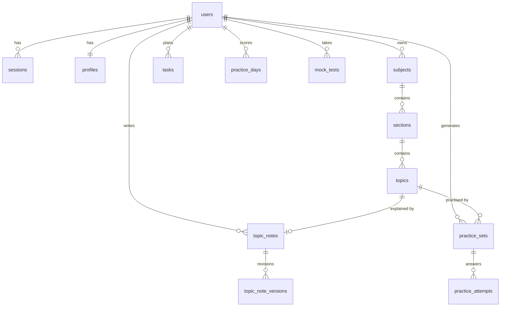

<div align="center">

# 🌿 Steady

**A calm placement-prep tracker. Your subjects, your pace, one day at a time.**

[](https://tanstack.com/start)
[](https://react.dev)
[](https://www.typescriptlang.org/)
[](https://tailwindcss.com)
[](https://turso.tech)
[](https://ai.google.dev)
[](https://web.dev/progressive-web-apps/)
[](https://bun.sh)

[Quick start](#-quick-start) · [Architecture](#-architecture) · [Features](#-whats-inside) · [Data model](#-data-model) · [AI pipeline](#-ai-pipeline) · [Deployment](#-deployment)

</div>

---

Steady is a **placement-preparation workspace** for students targeting SDE and cybersecurity roles. Pick the subjects you actually care about at signup, and Steady turns them into a dated, day-by-day plan with study tasks, AI-written topic notes, practice MCQs, mock tests, and quiet progress tracking.

No streak guilt, no infinite feed, no gamified noise. One screen tells you what today looks like; open a topic and the notes and questions are already written.

```
Today · Tue 20 Oct
├─ 3 tasks · 2 done · 45 min left
├─ Practice    6 / 10 solved
└─ Next up     DSA › Recursion › Base cases   → notes ✓  practice ✓
```

---

## ✨ What's inside

| Area | What it does |
| --- | --- |
| **Onboarding** | 4 steps: name → rhythm (start date + daily hours) → subject chips → plan preview. Generates a **182-day plan** on the spot. |
| **Dashboard** | Greeting, today's task list, practice progress, streak, and a jump into today's focus. |
| **Day view** (`/today`) | Every task for a date, check off, carry over missed work, or spread it across the week. |
| **Plan & schedule** | 26 weeks of subjects → sections → topics, with a weekly calendar and per-subject progress. |
| **Topic page** | **Notes and a practice set generate themselves on open.** Markdown notes (edit + regenerate), a 6-question MCQ quiz with explanations, and a personal notes tab. |
| **Practice** | Daily MCQ set (topic-aware, generated once per date) with instant feedback, attempt history and streak. |
| **Mock tests** | Subject-scoped tests with a timer, question palette, and a results screen with subject-wise + question-wise analysis. |
| **Progress** | Practice consistency calendar, accuracy, mock-test performance. |
| **PWA** | Installable, offline reads/writes through IndexedDB, queued writes that sync when you're back online. |

### The 60-second version of the flow

1. **Sign up** → onboarding asks four questions.
2. Steady seeds **subjects → sections → topics** and a **182-day task plan** into your own rows.
3. Every day you open `/today`, tick off tasks, and do the practice set.
4. Open any topic → notes and 6 MCQs appear (cached forever after the first visit).
5. Sunday-ish: take a mock test, review weak subjects in `/progress`.

<p align="center">
  
  
</p>
<p align="center"><sub>Open a topic and both the notes and the quiz are already written — no "generate" button.</sub></p>

---

## 🧱 Tech stack

| Layer | Choice | Why |
| --- | --- | --- |
| Framework | **TanStack Start** (React 19, SSR) | File-based routing, server functions, one deployable app |
| Routing | **TanStack Router** | Fully typed routes, `beforeLoad` guards, search params as state |
| Data fetching | **TanStack Query** | Cache, background refetch, optimistic task toggles |
| Server | **TanStack Start server functions** (`createServerFn`) | Type-safe RPC, no separate API layer |
| Database | **Turso / libSQL** (SQLite) | Local file in dev, hosted libSQL in prod — same SQL |
| Auth | **bcryptjs + HTTP-only cookie sessions** | No third-party auth dependency |
| AI | **Google Gemini** (`generateContent`) | Notes, MCQs, mock tests, code review |
| UI | **Tailwind CSS 4**, shadcn/ui (Radix), lucide icons | Calm, accessible primitives |
| Offline | **Dexie** (IndexedDB) + **Workbox** service worker | Practice keeps working on a train |
| Tooling | **Bun**, Vite 8, Vitest, ESLint, Prettier | Fast installs and builds |

---

## 🏗 Architecture

The whole app is **one TanStack Start deployment**: the browser talks to typed server functions, those functions are the only things allowed to touch SQLite, and Gemini is called exclusively from the server.



### The boundary that keeps it honest

`vite.config.ts` turns on TanStack Start's **import protection**: any client-reachable file that statically imports `**/server/**` fails the build. Server-only modules (`db`, `store`, `schema`, `gemini`) are always loaded through a **dynamic `import()` inside a `.handler()` callback**:

```ts
// src/lib/data.ts — the only shape client code sees
const getTasksFn = createServerFn({ method: "GET" })
  .validator(() => undefined)
  .handler(async () => {
    const { viewer } = await getViewerFn();          // typed RPC, not a global
    if (!viewer) throw new Error("Not signed in");
    const store = await import("./server/store");    // server-only, runtime-loaded
    return await store.getTasks(viewer.id);
  });
```

### Opening a topic (the most interesting path)



First visit waits on Gemini (seconds to a minute); every later visit is a single indexed SQLite read.

### Defence in depth

| Concern | Handling |
| --- | --- |
| Auth | `steady_session` HttpOnly, `SameSite=Lax`, `Secure` in production, 30-day expiry, bcrypt hashes (cost 10) |
| Authorisation | Every SQL statement filters by `user_id` — the SQLite stand-in for RLS |
| CSRF | `createCsrfMiddleware` on all server-function requests (`src/start.ts`) |
| Secrets | `GEMINI_API_KEY`, `TURSO_AUTH_TOKEN` only in server env; `.env` is git-ignored |
| Rate limits | 40 AI calls/hour per user, with a calm UI message |
| SSR failures | Request middleware + a server entry wrapper turn swallowed h3 errors into a styled 500 page |

---

## 🗄 Data model

13 tables, no ORM, everything created with `CREATE TABLE IF NOT EXISTS` on first use.



<details>
<summary><b>Table reference</b></summary>

| Table | Purpose |
| --- | --- |
| `users`, `sessions` | Email + bcrypt hash; opaque session tokens with expiry |
| `profiles` | Name, start date, daily target minutes, selected subjects, `plan_loaded` |
| `subjects` → `sections` → `topics` | Per-user copy of the curriculum tree; topics hold status, personal notes, resources |
| `tasks` | Dated plan items (`date`, `est_minutes`, `done`, `carried_over`) |
| `practice_sets` | One row per (user, date, kind); `kind` is `daily` \| `topic` \| `mock`. Topic sets store `date = topicId` so each topic's quiz is generated once and reused |
| `practice_attempts` | Every answer: question index, selected option, correctness, time |
| `practice_days` | Aggregated solved/total per date (feeds the streak and the consistency calendar) |
| `topic_notes`, `topic_note_versions` | AI notes with version history for manual edits |
| `mock_tests` | Test definition, answers, timing, score, per-subject breakdown |

</details>

---

## 📁 Project structure

```text
steady/
├─ src/
│  ├─ routes/
│  │  ├─ index.tsx                 landing page (public)
│  │  ├─ auth.tsx                  sign in / sign up
│  │  ├─ __root.tsx                document shell, providers, PWA wiring
│  │  └─ _authenticated/           every signed-in page
│  │     ├─ route.tsx              session guard + onboarding gate + AppShell
│  │     ├─ dashboard.tsx          today at a glance
│  │     ├─ today.tsx              day view, carry-over, practice card
│  │     ├─ schedule.tsx           weekly calendar
│  │     ├─ subjects.index.tsx      subject cards + progress
│  │     ├─ subjects.$subjectId.tsx one subject's sections and topics
│  │     ├─ topic.$topicId.tsx     notes + practice + personal notes
│  │     ├─ practice.tsx           daily MCQ session
│  │     ├─ mock-tests.tsx         test list + generation
│  │     ├─ mock-test.$testId*.tsx test runner + results
│  │     └─ progress.tsx           consistency + performance
│  ├─ components/
│  │  ├─ steady/                   AppShell, Onboarding, kit (Card, Shimmer, CalmError)
│  │  └─ ui/                       shadcn/Radix primitives
│  ├─ lib/
│  │  ├─ data.ts                   ~30 typed server functions + React Query hooks
│  │  ├─ auth.ts                   signUp/signIn/signOut, getViewerFn, useSession
│  │  ├─ curriculum.ts             subject seeds + 182-day plan generator
│  │  ├─ offline.ts                Dexie schema, sync queue, auto-sync
│  │  ├─ pwa.ts                    service-worker registration + update prompt
│  │  └─ server/                   ⚠️ server-only (build-enforced)
│  │     ├─ db.ts                  lazy libSQL client, migrate(), typed helpers
│  │     ├─ schema.ts              single source of truth for all DDL
│  │     ├─ store.ts               every SQL query, all scoped by user_id
│  │     └─ gemini.ts              model chain, retries, prompts, JSON schemas
│  ├─ start.ts                     request middleware (errors + CSRF)
│  ├─ server.ts                    SSR entry with a styled 500 fallback
│  └─ styles.css                   Tailwind theme tokens (calm palette)
├─ data/                           local SQLite (git-ignored)
├─ TURSO_SETUP.md                  local → Turso Cloud guide
├─ AGENTS.md                       conventions for AI coding agents
└─ vite.config.ts                  plugin chain, import protection, PWA config
```

---

## 🚀 Quick start

**Requirements:** [Bun](https://bun.sh) 1.2+ (Node 20+ also works). No database install needed.

```bash
git clone https://github.com/ayushjha-dev/Steady.git
cd Steady
bun install
cp .env.example .env     # Windows: copy .env.example .env
bun run dev              # → http://localhost:3000
```

Then sign up. The first signup creates the SQLite schema in `data/steady.db` and seeds your plan. Add a Gemini key to `.env` to turn on notes and practice generation:

```env
TURSO_DATABASE_URL="file:./data/steady.db"
TURSO_AUTH_TOKEN=""
GEMINI_API_KEY="your-key-from-aistudio.google.com/apikey"
```

<details>
<summary><b>Environment variables</b></summary>

| Variable | Required | Default | Notes |
| --- | --- | --- | --- |
| `TURSO_DATABASE_URL` | no | `file:./data/steady.db` | `libsql://…` for Turso Cloud |
| `TURSO_AUTH_TOKEN` | cloud only | — | Database token with read-write access |
| `GEMINI_API_KEY` | for AI | — | Used exactly as issued by AI Studio |
| `NITRO_PRESET` | no | `node-server` | Build-time only, e.g. `cloudflare-module` |

</details>

<details>
<summary><b>Scripts</b></summary>

| Command | What it does |
| --- | --- |
| `bun run dev` | Vite dev server with HMR on `:3000` |
| `bun run build` | Client build + Nitro server into `.output/` |
| `bun run preview` | Preview the production build |
| `bun run test` | Vitest (jsdom + Testing Library) |
| `bun run lint` / `bun run format` | ESLint / Prettier |

</details>

---

## 🤖 AI pipeline

All model calls live in `src/lib/server/gemini.ts`; the browser only ever sees `{ data, error, remaining }`.

- **Tasks:** `notes`, `daily_practice`, `topic_practice`, `mock_test`, `check_code`.
- **Model chain:** `gemini-3.7-flash` → `gemini-flash-lite-latest` → `gemini-3.1-flash-lite` → `gemini-3.6-flash` → `gemini-3.5-flash`. Google's free tier returns transient `503 high demand` per model, so failures rotate to the next one.
- **Retries:** up to 7 attempts across the chain on `429`, `5xx`, network errors and truncated JSON; capped exponential backoff; 35s timeout per attempt.
- **Structured output:** MCQs are requested with `responseMimeType: application/json` + a `responseSchema` (`question`, 4 `options`, `correct_index`, `explanation`, `difficulty`), then passed through a fence-tolerant parser.
- **Caching:** notes are stored per topic; practice sets are stored per topic (and per date for the daily set). Re-opening a page never re-calls the model.
- **Quota:** 40 calls/hour/user; the UI shows a gentle "take a breath" message instead of an error.

> Free-tier reality check: the first generation of a topic can take 10–60s (or longer during Google demand spikes). Everything after that is instant.

---

## 📴 Offline & PWA

- Installable manifest + Workbox service worker with `autoUpdate`.
- Google Fonts cached for a year (`CacheFirst`); app shell precached.
- `src/lib/offline.ts` mirrors practice sets, attempts, notes and mock tests into IndexedDB and keeps a **sync queue**; `setupAutoSync()` flushes it when the browser comes back online.
- `NetworkStatus` surfaces offline state without blocking the UI.

---

## ☁️ Deployment

`bun run build` emits a self-contained Nitro server:

```bash
bun run build
node .output/server/index.mjs      # serves on :3000
```

| Target | How |
| --- | --- |
| **Node / VPS / Docker** | Default preset (`node-server`); ship `.output/` and set env vars |
| **Vercel / Netlify / Cloudflare** | `NITRO_PRESET=<preset> bun run build` |
| **Database** | Point `TURSO_DATABASE_URL` at `libsql://…` and add `TURSO_AUTH_TOKEN`; schema self-migrates on first signup |
| **Secrets** | Set `GEMINI_API_KEY` and the Turso vars in the host's environment — never in the repo |

Full database walkthrough (local file, Turso Cloud, copying data): **[TURSO_SETUP.md](TURSO_SETUP.md)**.

---

## 🧪 Testing

```bash
bun run test     # Vitest + Testing Library
bun run lint
```

The suite covers app routing; the AI and database layers are exercised end-to-end (signup → onboarding → plan → notes → practice) against a real libSQL database during development.

---

## 🎨 Design principles

1. **Calm over clever.** Muted palette, generous whitespace, no red badges for being behind.
2. **One shell.** Every signed-in page renders inside `AppShell` — sidebar on desktop, tab bar on mobile.
3. **Plans are per-user data, not a hardcoded calendar.** The landing page never promises a duration; the plan length lives in `curriculum.ts`.
4. **No dead ends.** Missing notes or questions are generated, not hidden behind a button; failures offer one clear retry.
5. **Server owns the truth.** Client state is a cache; SQL is the source of truth, always scoped by `user_id`.

---

## 🗺 Roadmap & known gaps

- [ ] Weekly Review page (currently a placeholder at `/review`)
- [ ] Spaced-repetition "revise" queue built from practice attempt history
- [ ] Code-editor practice (`check_code` endpoint exists, UI is not wired)
- [ ] Shareable plan export (ICS / PDF)
- [ ] Move the AI rate limiter from per-process memory to the database for multi-instance deploys
- [ ] Clean up the remaining TypeScript strict-mode errors in the mock-test runner

---

## 📚 Docs

| File | Contents |
| --- | --- |
| [TURSO_SETUP.md](TURSO_SETUP.md) | Local SQLite, Turso Cloud, copying data, troubleshooting |
| [AGENTS.md](AGENTS.md) | Repo conventions for AI coding agents |
| [src/routes/README.md](src/routes/README.md) | File-based routing conventions |

---

<div align="center">

**Your subjects · your pace · 1 day at a time**

Built with TanStack Start, Turso and a lot of quiet evenings.

</div>
